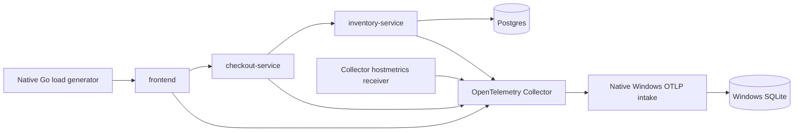

# Shop: M2 pool-exhaustion demo

Run from the repository root in **PowerShell**, with Go, Task, Docker Desktop's Linux engine, and Docker Compose available:

```powershell
task shop-demo
$demo = Get-Content -Raw .\benchmark\results\shop-demo.json | ConvertFrom-Json
.\bin\signalscout.exe runs list --db $demo.database --workload 'POST /checkout' --outcome fail
.\bin\signalscout.exe runs show $demo.evidence.run_id --db $demo.database
```

The task builds the native CLI and cross-compiles the sample with the native Go compiler (`GOOS=linux`, `CGO_ENABLED=0`). The small Docker build context contains only the resulting binary and Dockerfile. No WSL command, bash script, Go compiler container, or web framework is used.

## Topology and lifetime



The Go runner owns intake during the demo. The Collector exports to `host.docker.internal:14318`; native intake listens on `0.0.0.0:14318` for that connection. Sample ports are bound to loopback: frontend 18080, inventory health 18082, Collector health 13133. Postgres is private to Compose.

Every demo uses a new database under `.cache/shop-demo/run-*/signalscout.db`; existing databases are not reset or mixed into its checks. The generated `benchmark/results/shop-demo.json` records its path. The runner stops the containers, flushes exporters, and closes intake before returning. The SQLite file remains available for the native CLI. Use `task shop-down` to remove the stopped sample containers/network. Postgres uses tmpfs with synthetic data and a public local-demo password; no production credentials are needed.

## Workload and failure switch

The services use `otelhttp`, explicitly wired Go SDK trace/metric/log providers, and W3C trace propagation. Inventory uses pgxpool. Each resource records commit SHA, source dirty status, service/version/instance, Go/dependency versions, host, local region, phase, and pool/timeout/retry settings. Dirty status covers sample/helper/module/Task sources; generated measurements are excluded. SDK trace IDs remain unique; the workload seed controls carts, quantities, cache choices and scheduling groups.

The demo generates exactly 40 passing baseline requests with `DB_POOL_SIZE=20`, then recreates all three services with `DB_POOL_SIZE=5` and sends 300 loaded requests. Both phases use the same cart model and seed. Typical carts have 1..5 lines with varied SKUs and quantities. A stable SKU hash supplies a common cache hit/miss decoy. Bulk carts always validate against the database.

Each 100-request group starts five 80-line carts, waits until pgxpool reports five actual acquired connections, then starts three ordinary cache-miss carts. A parameterized inventory read includes `pg_sleep` to model per-line query work (405 ms for a bulk cart), identically in both phases. This is a read-only reservation-work simulation, not a complete commerce application. With five pool slots occupied, the three ordinary requests reach real 100 ms acquire deadlines, retry once after 10 ms, and fail. Remaining traffic runs after the burst. The intended failure frequency is approximately 3%; it is a designed burst workload, not a production-frequency estimate.

The runner checks the observed failure band (2..4%), exact current trace IDs and outcomes, phase/pool fingerprints, a slow `db.pool.acquire` span, `retry` event, correlated log, pool=5 gauge, and a separate host-only metric linked by `host.name`. These checks fail the task if evidence is missing. Load transport errors fail separately. Failed attempts keep their local database and command log.

```powershell
task shop-demo -- -seed 42 -failure-count 500
```

The loaded count must be a multiple of 100; baseline count stays 40.

## Host context

Collector contrib 0.147's [hostmetrics receiver](https://github.com/open-telemetry/opentelemetry-collector-contrib/blob/v0.147.0/receiver/hostmetricsreceiver/README.md) scrapes host load and memory every second. A dedicated pipeline adds only `host.name=docker-desktop`, producing a resource distinct from app resources. These are measurements of Docker Desktop's Linux environment, **not physical Windows OS metrics**. All app span resources use the same logical host label.

Application metrics include `db.pool.in_use`, `db.pool.capacity` and HTTP metrics. All signals are retained. Context uses the configured 30-second-before/5-second-after window. It may contain data from the preceding phase; raw configuration and rule provenance are retained, and M2 makes no context-difference claim. Context diffing and the explorer remain later milestones.

## Manual load against a running stack

After the first demo has built the image, start native intake in one PowerShell window:

```powershell
.\bin\signalscout.exe serve --listen '0.0.0.0:14318' --db .\.cache\shop-manual.db
```

In another window:

```powershell
$env:GIT_COMMIT = git rev-parse HEAD
$env:DB_POOL_SIZE = '20'
$env:SHOP_PHASE = 'baseline'
docker compose --project-name signalscout-shop --file .\samples\shop\compose.yml up --detach --wait
task shop-load -- -count 40 -concurrency 8 -seed 1
```

To enable the failure and send more traffic:

```powershell
docker compose --project-name signalscout-shop --file .\samples\shop\compose.yml stop frontend checkout-service inventory-service
$env:DB_POOL_SIZE = '5'
$env:SHOP_PHASE = 'failure'
docker compose --project-name signalscout-shop --file .\samples\shop\compose.yml up --detach --no-deps --force-recreate --wait inventory-service checkout-service frontend
task shop-load -- -count 300 -concurrency 8 -seed 1
task shop-down
```

`shop-load` also accepts `-url`, `-inventory-health`, `-phase`, and `-bursts=false`; burst load requires concurrency >=8. Manual mode leaves intake lifecycle to you. The automated task handles readiness, telemetry draining, database isolation, and verification.
